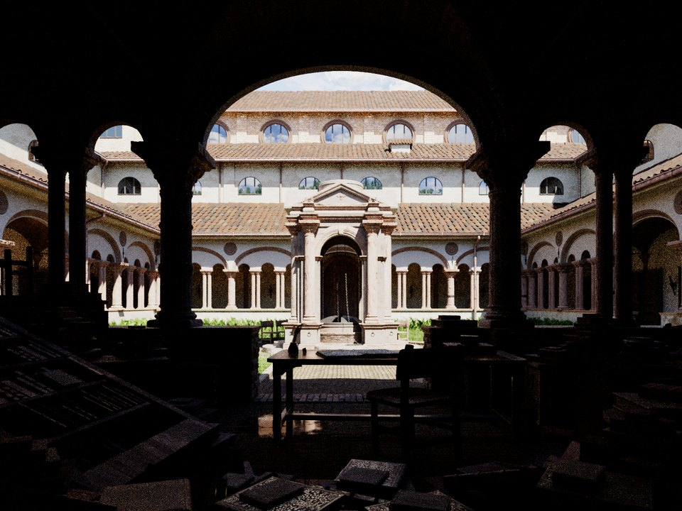
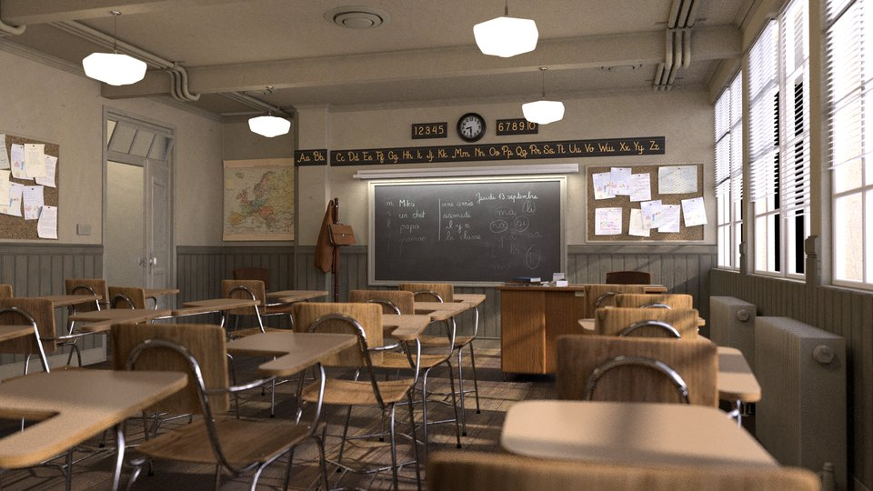

# Psycles

Psycles is a Cycles-compatible renderer built on LuisaCompute's multistage C++ DSL, XIR compiler, and runtime JIT. It implements Blender Cycles 5.2/5.3's Shader Virtual Machine (SVM), closure state machine, geometry/attribute contracts, and sampling/MIS pipeline natively across GPU (`hip`, `dx`, `vk`, `metal`, `metal4`) and CPU (`fallback`, `simd`) backends.

All material and scene evaluation domains — **surface, background, light emission, volume, and true/bump displacement** — compile and execute natively through Cycles SVM (`DirectJitTranslator` + bytecode VM fallback) with no legacy `SurfaceProgram` or separate CPU reference renderer.

## Documentation Map

- **Usage & Build:** [BUILD.md](BUILD.md) — prerequisites, CMake options, render CLIs, shader caching, test suites, troubleshooting
- **System Design:** [docs/architecture.md](docs/architecture.md) — end-to-end data flow, scene/graph contracts, SVM runtime, transport & coroutine scheduling
- **Optimization & Benchmarks:** [docs/optimization.md](docs/optimization.md) — DirectJit SVM, SSA stack elimination, wavefront coroutine splitting, surface sorting, backend tuning, and full 6-backend benchmark tables
- **Cycles Compatibility:** [docs/cycles-compatibility.md](docs/cycles-compatibility.md) — supported domains, specialization invariants, known feature gaps, verification policy
- **Benchmark & Diagnostics:**
  - [docs/scene-benchmark.md](docs/scene-benchmark.md) — equal-pass Blender Cycles vs Psycles multi-backend benchmark runner
  - [docs/cycles-path-trace.md](docs/cycles-path-trace.md) — per-path 344-AOV RNG/state differential oracle
- **Contributor Guide:** [DEVELOP.md](DEVELOP.md) — codebase layout, Cycles semantic/performance policies, CI and regression gates

## Quick Start

### Clone, Build, and Test

```bash
git clone --recurse-submodules https://github.com/LuisaGroup/Psycles.git
cd Psycles
cmake -S . -B build -G Ninja
cmake --build build --parallel 32
ctest --test-dir build --output-on-failure -j32
```

Psycles pins `third_party/LuisaCompute` (`next@2beb5a275`) as a CMake subdirectory. Useful CMake switches:

- `-DPSYCLES_ENABLE_LUISA_SIMD=ON` to build the packet-vectorized CPU SIMD backend alongside `fallback`
- `-DLUISA_COMPUTE_ENABLE_VK_XIR_SPIRV=OFF` to build the DXC-based Vulkan path instead of native XIR-to-SPIR-V
- `-DPSYCLES_ENABLE_LUISA=OFF` for a dependency-free contract/compiler-only build

See [BUILD.md](BUILD.md) for platform packages, GPU SDK setup, and selective CTest targets.

### Render

Built-in smoke demo:

```bash
./build/bin/psycles_luisa_render_demo output.ppm fallback 640 400 256
```

Normalized Blender scene package on any enabled backend (`hip`, `dx`, `vk`, `metal`, `fallback`, `simd`):

```bash
./build/bin/psycles_render_blender_scene /path/to/export-package output.ppm vk 1920 1080 256
```

To force the GPU `wavefront-staged` scheduler directly from the CLI, pass the trailing scheduler selection arguments documented in [BUILD.md](BUILD.md#render-clis). On multi-GPU AMD systems with an integrated GPU at index 0, set `HIP_VISIBLE_DEVICES=1` for `hip`.

## Showcase

Tonemapped previews from verified 256 spp `wavefront-staged` renders (combined gallery size `440.5 KiB` JPEG):

| Scene | Scene |
| :---: | :---: |
| <br/>**`bmw27`** — 960×540 · `vk-xir` **1.200 s** *(2.70×)* | <br/>**`monster`** — 1024×1024 · `vk-xir` **5.665 s** *(2.36×)* |
| <br/>**`lone-monk`** — 1440×1080 · `vk-xir` **4.685 s** *(2.84×)* | <br/>**`classroom`** — 1920×1080 · `vk-xir` **7.454 s** *(2.29×)* |
| <br/>**`barbershop`** — 2048×858 · `dx` **17.031 s** *(1.43×)* | |

## Verified Six-Backend Performance Summary

Measured on `LuisaCompute next@2beb5a275` (AMD Ryzen 9 9950X3D + AMD Radeon RX 9070 XT) against official **Blender Cycles 5.3.0** across all 5 canonical scenes with **0 invalid pixels** on all 30 `(scene, backend)` combinations (and **421/421** CPU CTests passing):

### GPU — 256 spp (`wavefront-staged`, Warm `r1`) vs Cycles 5.3.0 HIPRT

| Scene | Cycles 5.3.0 HIPRT | Psycles `hip` | Psycles `dx` | Psycles `vk-dxc` | Psycles `vk-xir` | Best Speedup |
| --- | ---: | ---: | ---: | ---: | ---: | ---: |
| `bmw27` (960×540) | 3.238 s | 2.418 s *(1.34×)* | 1.217 s *(2.66×)* | 1.489 s *(2.17×)* | **1.200 s** *(2.70×)* | **2.70× (`vk-xir`)** |
| `monster` (1024×1024) | 13.348 s | 8.260 s *(1.62×)* | 6.078 s *(2.20×)* | 6.802 s *(1.96×)* | **5.665 s** *(2.36×)* | **2.36× (`vk-xir`)** |
| `lone-monk` (1440×1080) | 13.315 s | 10.984 s *(1.21×)* | 4.847 s *(2.75×)* | 5.463 s *(2.44×)* | **4.685 s** *(2.84×)* | **2.84× (`vk-xir`)** |
| `classroom` (1920×1080) | 17.046 s | 14.414 s *(1.18×)* | 7.583 s *(2.25×)* | 8.047 s *(2.12×)* | **7.454 s** *(2.29×)* | **2.29× (`vk-xir`)** |
| `barbershop` (2048×858) | 24.368 s | 22.495 s *(1.08×)* | **17.031 s** *(1.43×)* | 17.042 s *(1.43×)* | 18.158 s *(1.34×)* | **1.43× (`dx`)** |

### CPU — 64 spp (`megakernel`, Warm-Cache Mean) vs Cycles 5.3.0 CPU

| Scene | Cycles 5.3.0 CPU | Psycles `fallback` | Psycles `simd` (W8) | Best Speedup |
| --- | ---: | ---: | ---: | ---: |
| `bmw27` (960×540) | 2.894 s | **2.486 s** *(1.16×)* | 2.744 s *(1.05×)* | **1.16× (`fallback`)** |
| `monster` (1024×1024) | 12.686 s | **10.289 s** *(1.23×)* | 11.174 s *(1.14×)* | **1.23× (`fallback`)** |
| `lone-monk` (1440×1080) | 22.948 s | 15.710 s *(1.46×)* | **15.578 s** *(1.47×)* | **1.47× (`simd`)** |
| `classroom` (1920×1080) | 24.498 s | 21.282 s *(1.15×)* | **20.405 s** *(1.20×)* | **1.20× (`simd`)** |
| `barbershop` (2048×858) | 37.492 s | **29.955 s** *(1.25×)* | 34.533 s *(1.09×)* | **1.25× (`fallback`)** |

Full cold/warm JIT timings, RMSE parity tables, and compiler/scheduler strategy breakdowns are in [docs/optimization.md](docs/optimization.md). Unsupported shader/geometry features fail cleanly with explicit compiler diagnostics rather than silent approximations; see [docs/cycles-compatibility.md](docs/cycles-compatibility.md).
